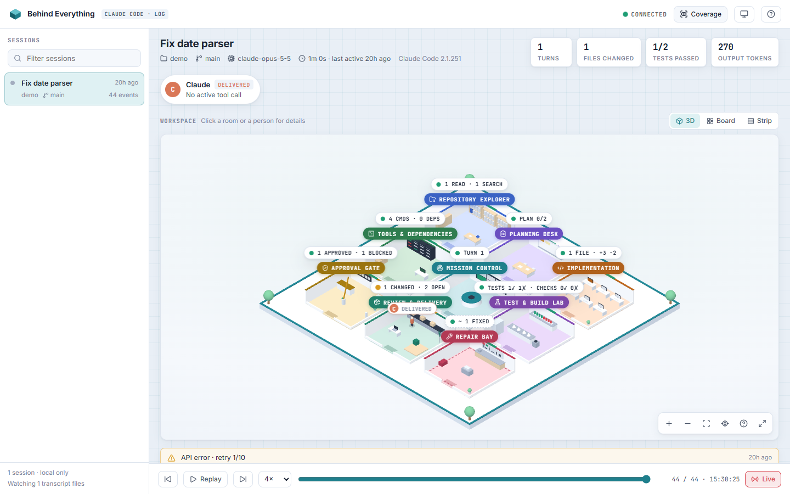
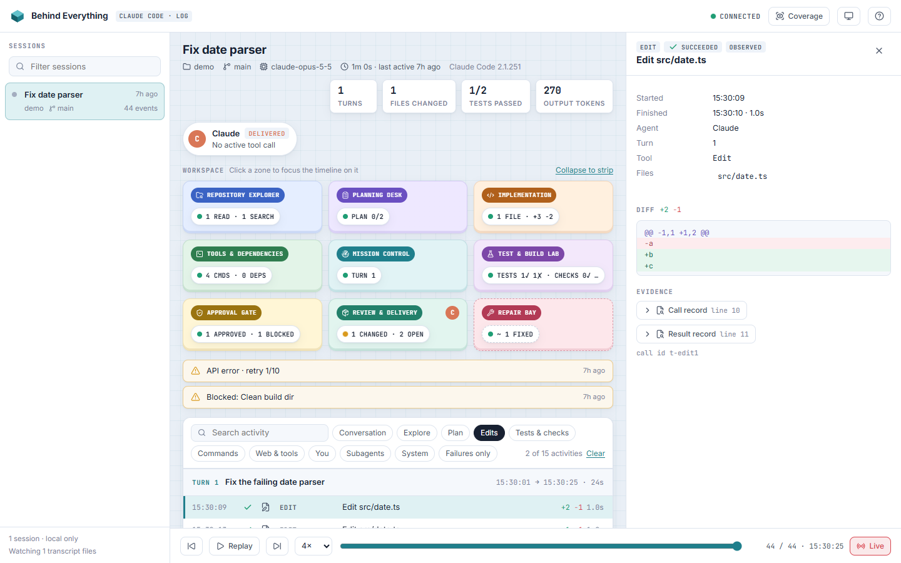

# Behind Everything

See what your AI coding agent is actually doing.

Behind Everything is a local-first app that watches Claude Code, Codex and GitHub Copilot CLI sessions
as they run and turns their real activity (files read, edits made, commands run, tests, approvals, subagents)
into a live 3D workspace, a searchable timeline and replayable sessions.

Every signal is labelled **observed**, **inferred** or **unavailable**. Nothing leaves your machine.



- Website: <https://git-me-harish.github.io/Behind_Everything-/>
- Product brief: [docs/agent_activity_visualizer_product_concept.docx](docs/agent_activity_visualizer_product_concept.docx)
- Architecture & roadmap: [docs/PLAN.md](docs/PLAN.md)
- What we can and can't see: [docs/CAPABILITIES.md](docs/CAPABILITIES.md)

## Quick start

```sh
npx behind-everything
```

Requires Node.js 22 or newer (Windows, macOS, Linux). Your browser opens at <http://127.0.0.1:47821>. Use Claude Code, Codex or Copilot CLI (in the terminal or VS Code) as usual in any project. Its activity appears live. Logs are read from `~/.claude/projects`, `~/.codex/sessions` and `~/.copilot/session-state` (`CLAUDE_CONFIG_DIR` / `CODEX_HOME` / `COPILOT_HOME` respected).
Nothing to configure in any of them. Options: `npx behind-everything --help`. Stop it with Ctrl+C; its data lives in `~/.behind-everything`.

From a clone: `pnpm install && pnpm start`.

## What you see

| | |
| --- | --- |
| **Sessions** | Every recent Claude Code, Codex and Copilot session, live ones marked, each with its assistant's mark. Pick one to explore. Collapse the list (top-left button or `s`) for a wider workspace; it stays the way you left it. On phones it is a drawer. |
| **Agents** | Claude and any subagents, each with its current phase (exploring, implementing, testing, waiting for you…) and the tool call it is running, with a live timer. |
| **Workspace** | An isometric building with nine rooms (Explorer, Planning, Implementation, Tools, Mission Control, Test & Build Lab, Approval Gate, Review, Repair Bay), each with a live status pill. Every assistant walks the corridors as its mascot, in voxels: Claude's pixel crab, Codex's plush blue cloud in a beret (its subagents are the heart, the frog and the triangle) and Copilot's goggled head. They go to the room of what they are doing now, show when a tool runs or they wait for you, and blink now and then. The furniture is data: books are files read, sticky notes are plan items, lit monitors are files changed, test tubes are verdicts, crates are files ready for review; the Approval Gate's barrier drops while something waits for you and the Repair Bay beacon turns while a failure is unfixed. Click a room for its details, a person for what they are doing. Also available as a flat board or a strip. |
| **Needs attention** | Approvals and questions waiting for you, failed tests and commands, blocked actions, edit loops, commands running too long. Click to jump to the evidence. |
| **Timeline** | Every action, grouped by turn: tool calls paired with their results, exit codes, durations, diff sizes. Filter by kind, failures, agent or file; search everything. |
| **Details** | The full story of one action: command and output, the actual diff, the plan, the question and your answer, permission decisions, and the raw transcript record it came from. |
| **Replay** | Drag the scrubber or press play: the whole screen shows the session exactly as it was at that moment. |
| **Coverage** | What the collector can and cannot see, how many values were redacted, and any record types it did not recognise. |



**Honest by design.** Anything derived rather than read directly is marked *inferred* (dashed outline, `~`) and links to
the events behind it: for example the Repair Bay, or a test run that exited 0 but whose output reports failures
(usually a piped command). The model's private reasoning is never shown; only that it reasoned, and for how long.

### Know when an agent is waiting for you

A session waiting on you (an approval or a question) gets a pulsing amber dot and a **Waiting for you** pill in the
sessions list, and the tab title counts them: `(1) Waiting`. Turn on the bell in the top bar for a desktop
notification; clicking it opens that session.

Copilot logs its approval prompts as they open, so they show up with nothing to install. Claude Code and Codex only
write an approval once you have answered it; to see their prompts while they wait, opt in to the hook bridge:

```sh
npx behind-everything hooks install     # adds one background PermissionRequest hook to Claude Code and Codex (config backed up first)
npx behind-everything hooks status      # installed? receiving?
npx behind-everything hooks uninstall   # removes exactly what install added
```

The hook only forwards the request to Behind Everything on 127.0.0.1. It never answers a prompt, never blocks, prints
nothing, and does nothing when Behind Everything is not running. Codex runs a new hook only after you trust it
(`/hooks` in the Codex CLI). Details: [docs/CAPABILITIES.md](docs/CAPABILITIES.md#hook-bridge-opt-in-claude-code-and-codex).

### Keyboard

`j`/`k` next/previous · `Esc` close · `/` search · `f` failures only · `Space` play/pause · `[` `]` step · `l` live · `s` sessions list · `?` help

On the map: drag to move · Ctrl/⌘ + scroll, trackpad pinch or two-finger pinch to zoom · with the map focused, arrow keys move, `+`/`−` zoom, `0` fits.
Full screen (⤢) gives the map every gesture; `Esc` returns.

### Devices and browsers

Works on phones, tablets, laptops and large screens, with touch, mouse, pen or keyboard, in Chrome, Edge, Firefox and Safari
(browser tests run on Chromium, Firefox and WebKit at seven screen sizes). The 3D map needs WebGL 2; without it, or if
the graphics driver gives up, the flat board takes over and says why. *Reduce motion* is honoured: agents and the
camera jump instead of moving.

## API

The UI is built on a small local API you can use directly:

| Endpoint | Returns |
| --- | --- |
| `GET /api/health` | Collector status and sources |
| `GET /api/sessions` | Sessions, most recent first |
| `GET /api/sessions/:id/events?after=<seq>` | A session's events in list form (bulky outputs and diffs left out) |
| `GET /api/events/:id` | One event in full |
| `GET /api/events/:id/evidence` | The raw (redacted) transcript record behind an event |
| `WS /ws` | Live `events` and `sessions` messages |

Data lives in `~/.behind-everything/events.sqlite` (override with `BE_HOME`); sessions are kept 30 days (`--retention`).
The server binds to `127.0.0.1` only and refuses requests from other hosts and origins.

## Development

```sh
pnpm dev            # collector + Vite with hot reload on http://localhost:5173
pnpm typecheck
pnpm test           # unit + integration tests on synthetic fixtures
pnpm test:e2e       # browser tests (PW_CHANNEL=msedge or chrome uses an installed browser)
pnpm test:local     # drift check: parses your real Claude Code, Codex and Copilot logs (never leaves your machine)
```

README screenshots come from the synthetic test session: `BE_SCREENSHOTS=1 pnpm test:e2e`.

### Product site

The website lives in `site/` and reuses the app's own renderer, mascots and theme: its hero is the real 3D world
playing a scripted session.

```sh
pnpm site:dev       # http://localhost:5174/Behind_Everything-/
pnpm site:build     # into dist-site/ (SITE_BASE=/ for a root domain)
pnpm test:site      # browser tests against the build
BE_SITE_SHOTS=1 pnpm test:e2e e2e/site-shots.e2e.ts   # regenerate the feature screenshots from the app
pnpm site:assets    # regenerate the hero poster and the social card (after site:build)
```

Pushing to `main` deploys it to GitHub Pages.

### Releasing

Bump `version` in package.json, then `git tag vX.Y.Z && git push --tags`. The release workflow checks, builds and
publishes to npm with provenance (it needs an `NPM_TOKEN` repository secret) and creates the GitHub release.

## Contributing

- `main` is always releasable; work happens on `feat/*`, `fix/*`, `chore/*` branches and lands via pull request.
- Commits follow [Conventional Commits](https://www.conventionalcommits.org/) (`feat:`, `fix:`, `chore:`, `docs:`, `test:`).
- CI must be green before merge (typecheck, unit/integration tests, build, browser tests).

## License

Apache-2.0
